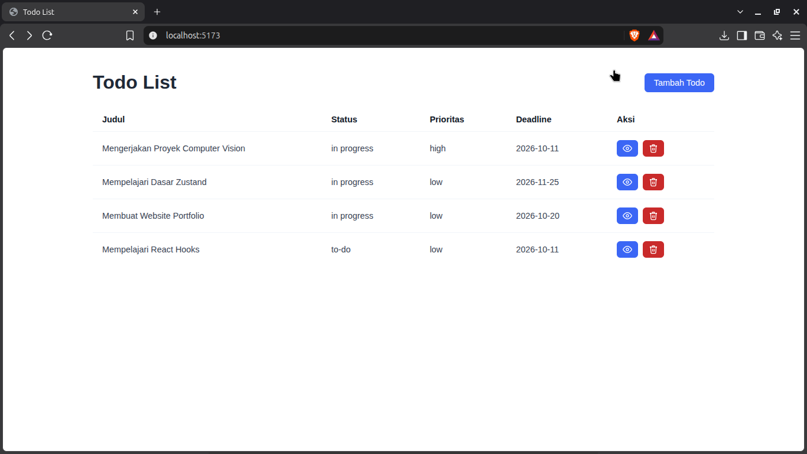
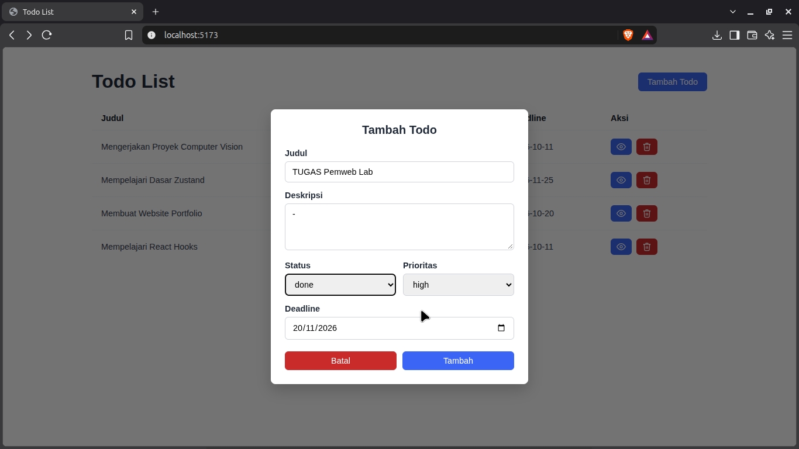
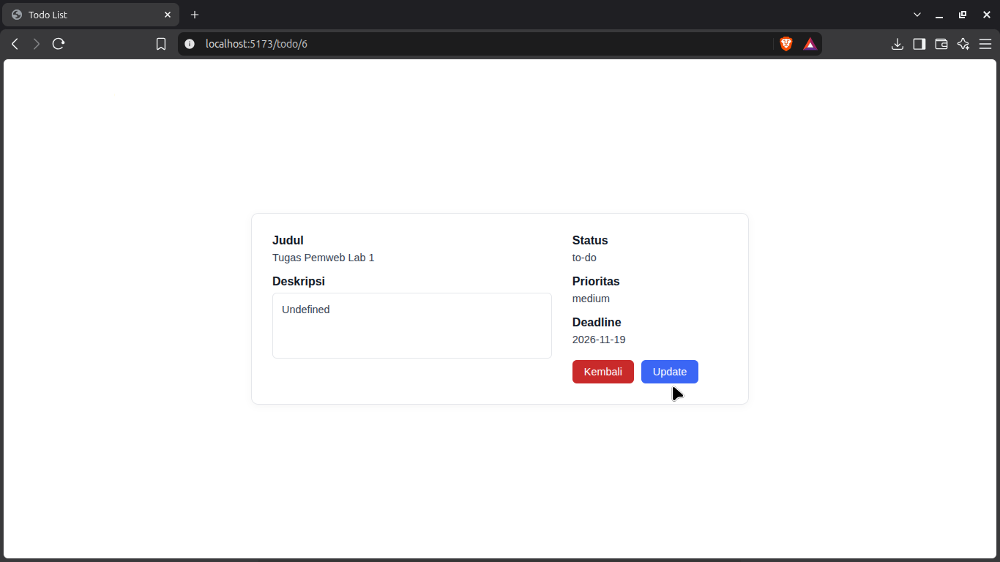
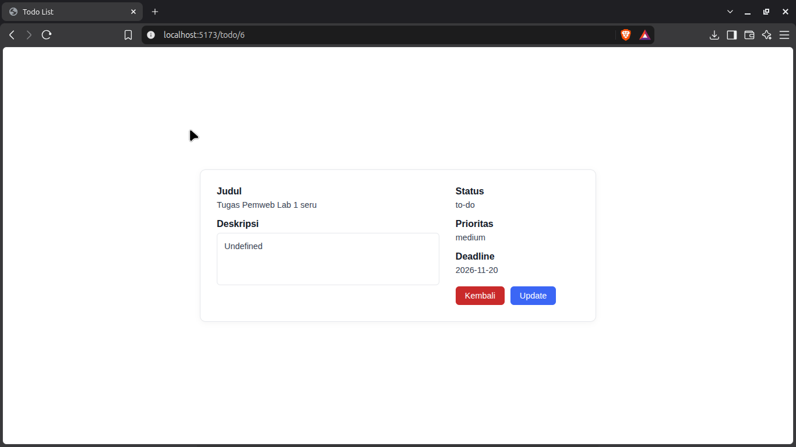
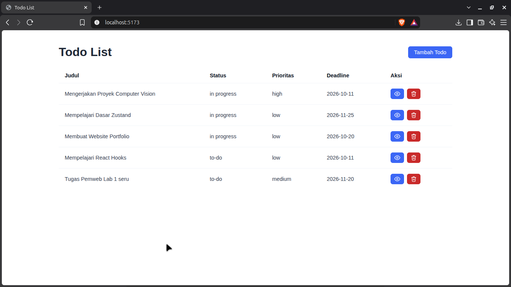
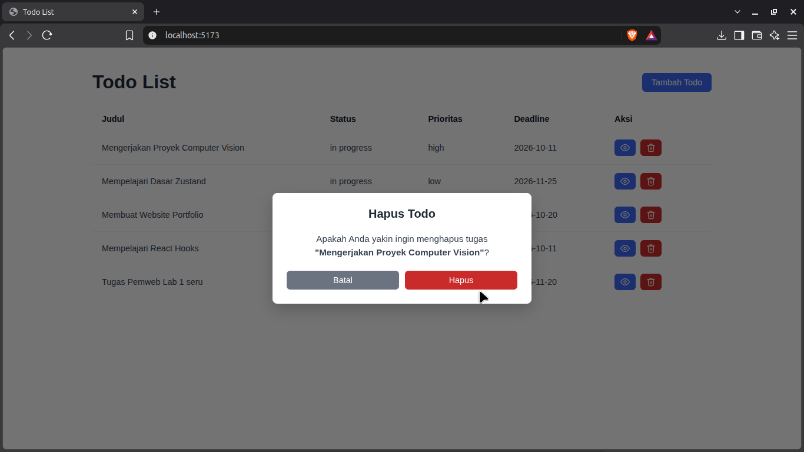
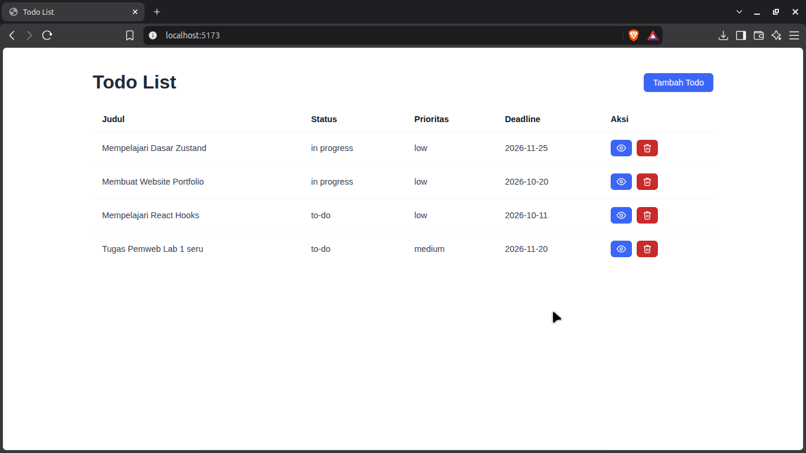

# Aplikasi To-Do List Frontend (React.js)

Aplikasi web To-Do List berbasis React.js untuk mengelola daftar tugas sehari-hari menggunakan React State dan data dummy.

## Fitur Utama
- **Menampilkan Tugas**: Menampilkan daftar tugas dalam bentuk tabel (Judul, Status, Prioritas, Deadline, dan Aksi).
- **Melihat Detail Tugas**: Menampilkan informasi lengkap setiap tugas pada halaman `/todo/:id`.
- **Menambahkan Tugas**: Menambahkan tugas baru melalui modal formulir tanpa memuat ulang halaman.
- **Memperbarui Tugas**: Mengubah informasi tugas yang sudah ada melalui modal formulir pada halaman detail.
- **Menghapus Tugas**: Menghapus tugas disertai modal konfirmasi sebagai umpan balik kepada pengguna.

## Struktur Data Tugas
Setiap tugas memiliki atribut:
- `id`
- `title`
- `description`
- `priority`
- `deadline`
- `status`

## Cara Menjalankan Aplikasi
1. Clone repository ini:
   ```bash
   git clone <link-repository-github-anda>
   cd todo-list-react
   ```
2. Install dependencies:
   ```bash
   npm install
   ```
3. Jalankan server pengembangan:
   ```bash
   npm run dev
   ```
4. Buka alamat lokal yang muncul di terminal (biasanya `http://localhost:5173`).

## Screenshot Implementasi

### 1. Halaman Utama (Daftar Tugas)


### 2. Modal Tambah Tugas


### 3. Hasil Setelah Menambahkan Tugas


### 4. Halaman Detail Tugas (Sebelum Update)


### 5. Halaman Detail Tugas (Setelah Update)


### 6. Daftar Tugas Setelah Update


### 7. Konfirmasi Hapus Tugas


### 8. Hasil Setelah Menghapus Tugas

